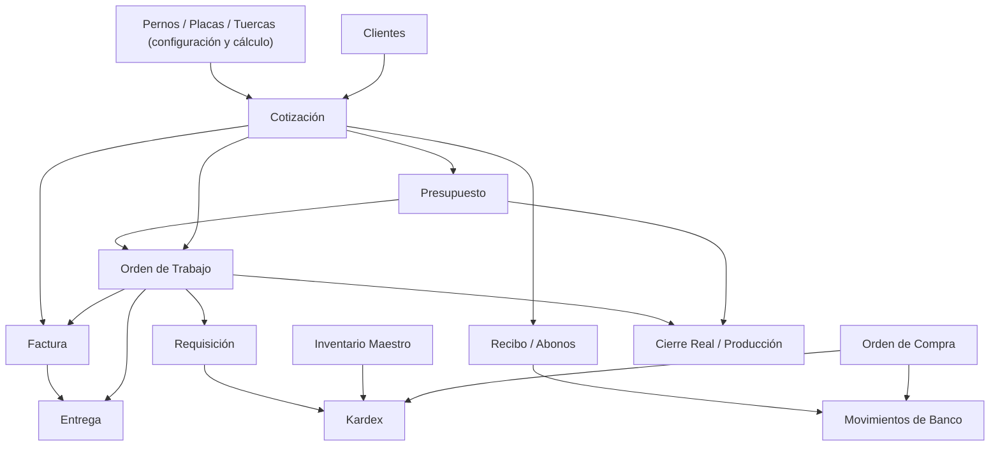

# Plan de clonación y conciliación COREBOLT V106.62 — puertas de validación

**Restricción contractual:** no modificar V106.62, no trasladar información real hasta contar con réplica funcional y respaldo verificado. La base Supabase `Duralco-Industrial-Dev` permanece aislada.

## A. Mapa lógico de origen (no es diagrama físico SQL definitivo)

Las conexiones muestran dependencias detectadas, **no** que todas sean FKs obligatorias. Por ejemplo: factura histórica manual puede no tener cotización; entrega puede originarse en OT; OC puede no tener OT.

## B. Secuencia y criterios de aceptación

| Puerta | Entrega | Prueba exigida | Autoriza |
|---|---|---|---|
| G0 | Copia congelada V106.62 e inventario de fuentes | Hash archivo original; respaldo con fecha, dispositivos y fuente remota identificados | Auditor técnico |
| G1 | Matriz de 27 vistas, 57 claves + 9 extras, contratos y fórmulas | Inspección de lógica efectiva; pruebas de referencia con datos sintéticos | Usuario tras revisión |
| G2 | Modelo SQL relacional equivalente con staging | FKs, UUID interno, número visible texto, RLS, auditoría, idempotencia y snapshots históricos; pruebas sin datos reales | Equipo técnico |
| G3 | Interfaz y lógica operativa reproducidas | Capturas y casos funcionales por módulo, formatos PDF, calculadoras y correlativos | Usuario por módulos |
| G4 | Migración de ensayo con respaldo autorizado | Cantidad de documentos, vinculación, valores y anulaciones; reporte de excepciones | Usuario antes de carga final |
| G5 | Corte operacional | Cambio controlado, conciliación L 0.00, conteo Kardex e inventario, último correlativo, pruebas entre usuarios | Usuario |
| G6 | Mejoras posteriores | Cambios versionados con comparación contra G5 y reversión | Usuario por cambio |

## C. Congelación de funcionalidad

No modificar en la clonación:
- Algoritmos y precios de Pernos, Placas, Tuercas.
- ISV, descuentos, redondeos, tipos de venta y condiciones.
- Lógica efectiva de `diagnosticarCadenaFactura`, emisión, validación y recibos.
- Correlativos visuales y códigos históricos.
- Formatos y contenidos de documentos PDF.
- Reglas de inventario y Kardex, para que el resultado sea equivalente.

Mejoras técnicas permitidas **sin alterar resultados**:
- Seguridad de acceso, gestión de secretos del lado servidor.
- SQL transaccional, integridad y constraints compatibles con los datos.
- Registro de procedencia, auditoría, validación y control de acceso.
- Pruebas automatizadas y entornos de pruebas aislados.

## D. Cuadro obligatorio de conciliación

Para cada tabla/documento:
- Conteo fuente / destino / diferencia.
- Conteo `nulo`, `anulada`, vigente, reparado, histórico manual.
- Lista de números únicos y duplicados por tipo, y resolución manual cuando proceda.
- Total bruto de cotizaciones y facturas por moneda, impuesto, descuentos y versión.
- Total recibos activos, saldo de cotización y situación de anticipos.
- Compras, entradas/salidas del banco, reversas y sumatoria por cuenta.
- Inventario Maestro, Kardex y movimientos netos por ID+unidad.
- Referencias válidas, huérfanas, ambiguas y reconstruidas por heurística.
- Últimos números emitidos y counters, sin reusar números anulados.

**Límite:** L 0.00 de diferencia monetaria en movimientos conciliados, o excepción documentada y aprobada. No se permite 'corregir' datos históricos silenciosamente.

## E. Observaciones de infraestructura ya creada

- Next.js/Supabase/Netlify y GitHub constituyen solo la **infraestructura de desarrollo**.
- `cotizaciones`, `presupuestos`, `ordenes_trabajo` y demás tablas preliminares requieren revisión contra contratos V106.62 antes de importar.
- No se han migrado datos reales a las tablas comerciales. Debe mantenerse así hasta G3.
- La pantalla creada inicialmente `/catalogo` y la tabla propuesta `catalogo_insumos` se retiraron porque no reproducían un módulo original.
- No usar el servicio de correos de autenticación como condición para desarrollar pruebas SQL aisladas, pero sí se necesitará ingreso real para aceptar G3.

## F. Siguiente punto donde sí se necesitará al usuario

1. Confirmar cuál copia de V106.62 representa producción **en la fecha de corte** (ya hay una copia para auditoría).
2. Entregar por un canal seguro un respaldo íntegro **cifrado** del sistema y, si existen, inventarios/kardex de los dispositivos o almacenamiento compartido, **sin publicar contraseñas ni secretos en GitHub**.
3. Validar discrepancias entre fuentes y autorizar importación de ensayo en la base de desarrollo.

**Hasta entonces:** auditar y diseñar sin tocar documentos operativos.
